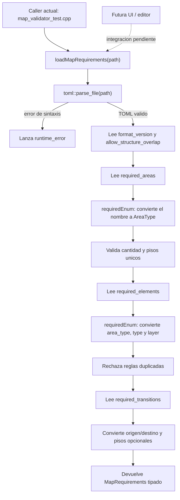
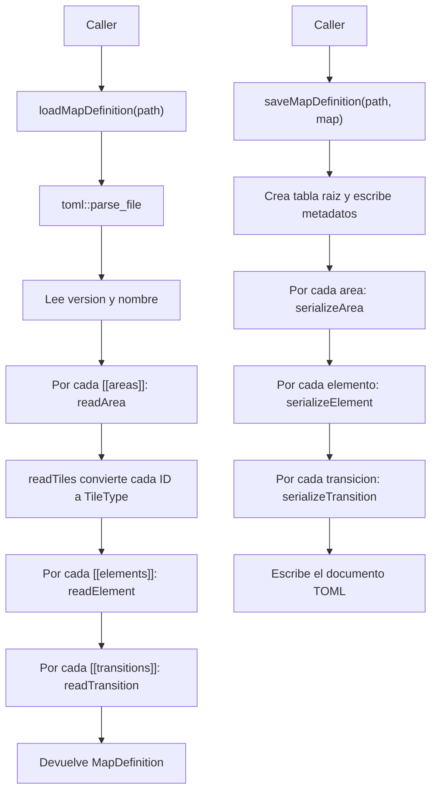
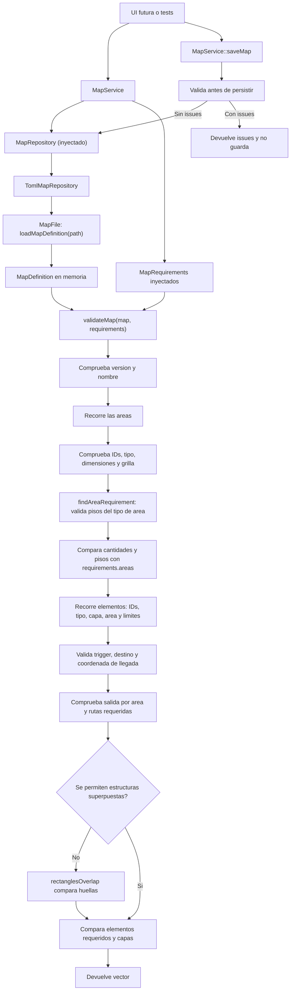

# Flujo del loader y el validador de mapas

## Carga de requisitos

El archivo `config/map_requirements.toml` define cantidades de areas, pisos, elementos obligatorios, capas y destinos de transicion.

`TomlTableReader` es la interfaz comun que usan ambos loaders. Recibe una tabla y un contexto, y ofrece lecturas de valores opcionales/obligatorios, enteros, enums y arrays. `requiredArray()` reutiliza `optionalArray()` y solo agrega el error para el caso ausente. Los nombres de enums se convierten mediante `areaTypeFromString`, `elementTypeFromString` y `elementLayerFromString`; un nombre desconocido produce un error.

## Lectura y escritura del mapa

### Que hace cada bloque

`loadMapDefinition(path)` parsea el archivo con `toml::parse_file`. Luego lee los metadatos y recorre cada array TOML. `readArea`, `readElement` y `readTransition` convierten una entrada individual al modelo C++; `readTiles` convierte cada nombre de terreno a `TileType`. Por eso el parser rechaza nombres desconocidos de area, tile, elemento o capa. Algunos campos semanticos pueden quedar ausentes (`optional`) para que `validateMap()` explique el problema; los datos necesarios para interpretar la forma de una entrada, como una fila TOML que no sea array, se rechazan durante la lectura.

`saveMapDefinition(path, map)` hace el camino inverso: crea una tabla TOML raiz, escribe metadatos y agrega arrays para areas, elementos y transiciones. `serializeArea`, `serializeElement` y `serializeTransition` convierten cada objeto al conjunto de claves propio de su tipo. Al final `toml++` imprime el documento y el stream comprueba que la escritura haya funcionado.

Hay un loop por cada coleccion porque solo cambia la funcion especializada que serializa cada objeto. No se unificaron en un serializador generico: area, elemento y transicion tienen campos diferentes, y una abstraccion con callbacks ocultaria ese mapeo en lugar de simplificarlo.

### Tipos y helpers

- `MapArea`, `MapElement`, `MapTransition` y `MapDefinition` usan `operator== = default` para comparar sus miembros automaticamente. El test de round-trip usa esa igualdad para comprobar que guardar y volver a cargar conserva todos los datos.
- `optionalFloor()` lee `from_floor` o `to_floor` de una regla. Si el campo no esta, la regla aplica a cualquier piso de ese tipo; si esta, debe ser un entero positivo.
- `optionalArray()` distingue una coleccion ausente de una clave presente con tipo incorrecto. La primera devuelve `nullptr` y se interpreta como vacia; la segunda lanza un error. El puntero apunta a memoria propiedad de la tabla TOML.
- `namespace stardew::maps` se abre en varios archivos para poner sus declaraciones y definiciones en el mismo namespace. `TomlTableReader` vive en `stardew::maps::detail` porque lo reutilizan ambos loaders. Los helpers como `readArea()` y `serializeTransition()` permanecen privados en `MapFile.cpp`: conocen el esquema del mapa, no son utilidades TOML genericas.

## Validacion del mapa

`MapService` recibe un `MapRepository` y `MapRequirements` por constructor. El caller solo pide cargar o guardar; el servicio coordina persistencia y validacion. El resultado de carga es el mapa junto con `vector<MapValidationIssue>`: vacio significa que el mapa es valido; cada issue contiene un `MapIssueCode` y solo los datos de contexto aplicables.

La validacion es acumulativa: informa varios errores en una sola llamada. Por ejemplo, un `StructureOverlap` identifica `areaId`, `elementId` y `relatedElementId`; un `RequiredElementWrongLayer` agrega tipo, capa esperada y capa actual. La UI puede convertir el codigo y esos datos en un mensaje localizado sin analizar texto generado por el validador. Los tests comparan codigos y payloads exactos, no redacciones.

## Estado de integracion

Los tests cargan `map_requirements.toml` y `examples/maps/basic_valid.toml` / `basic_missing.toml` mediante `MapService`. La UI todavia no esta conectada: sera otro caller del servicio. `TomlMapRepository` implementa `MapRepository`; en tests se usa el mismo adaptador para verificar el recorrido real de archivos.
